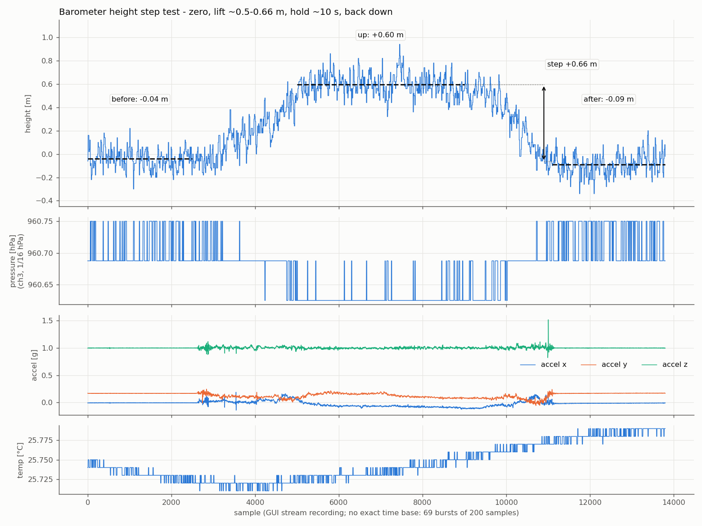

### 🔹 LPS22HB barometer SPI driver and height

Driver for the ST LPS22HB absolute pressure sensor over SPI (`baro_lps22hb`): it resets and identifies the chip, configures it, and then reads pressure and temperature on every `i_tick`, as a signed 24-bit pressure (4096 LSB/hPa) and a signed 16-bit temperature (100 LSB/°C). A second, optional module (`baro_height`) turns the pressure into a height above a reference point taken on request, in 2 cm steps. The LPS22HH (`WHO_AM_I` `0xB3`) has a different register map: this driver is not meant for it.

✔️ Verified via testbench: the driver against a behavioural model of the chip's SPI port that flags any edge that is not SPI mode 3 (register writes in order, `WHO_AM_I` retries, burst reads with and without new data, an absent chip, tick timing and overrun); the height against the exact barometric formula.

🧪 Status: Tested on real hardware with an LPS22HB on a Spartan-7 (xc7s50) board, 25 MHz clock, ticks at 26 Hz, on an SPI bus shared with an LSM6DSM IMU (2026-10-16): it identifies and configures the chip, pressure and temperature are plausible for the site, height noise is ~9 cm RMS and a ~0.6 m lift reads +0.66 m (see [Verification](#verification)). Not yet checked on hardware: whether `STATUS.P_DA` clears on reading as assumed, and the height scale against a height measured with a tape.

🏷️ Version: v1.0.0 (2026-10-25), see the [changelog](#changelog).

📁 [Source Code: driver](source/baro_lps22hb.v)

📁 [Source Code: height](source/baro_height.v)

📁 [Testbench: driver](test/baro_lps22hb_tb.sv) (`python run.py`)

📁 [Testbench: height](test/baro_height_tb.sv) (`python run_height.py`)

`baro_lps22hb` depends on `spi_master.v` from the [SPI module](../spi/spi.md), instantiated internally; it needs the version with `p_cpha`. `baro_height` needs nothing else and does not touch the bus.

📌 Instantiation:

```verilog
baro_lps22hb # (
    .p_spi_prescaler(),        /* spi_master prescaler: SCLK = clk / (2*(p_spi_prescaler/2+2)), at most 10 MHz */
    .p_reset_wait_cycles(),    /* clk cycles to wait after SWRESET */
    .p_who_am_i(),             /* expected WHO_AM_I: 8'hB1 LPS22HB */
    .p_id_retry_wait_cycles(), /* clk cycles before reading WHO_AM_I again after a wrong answer */
    .p_id_max_attempts(),      /* WHO_AM_I reads before giving up (1-15), 0 = never give up */
    .p_odr(),                  /* CTRL_REG1.ODR[2:0], output data rate */
    .p_en_lpfp(),              /* CTRL_REG1.EN_LPFP, low-pass filter on pressure */
    .p_lpfp_cfg()              /* CTRL_REG1.LPFP_CFG, filter bandwidth */
) baro_lps22hb (
    .clk(),
    .rst(),              /* Synchronous reset, active high */
    .i_tick(),           /* One-clock pulse: the driver may start its next SPI transaction */
    .o_spi_cs_n(),
    .o_spi_sck(),
    .o_spi_mosi(),
    .i_spi_miso(),
    .os24_pressure(),    /* Signed, 4096 LSB/hPa */
    .os16_temperature(), /* Signed, 100 LSB/degC */
    .or_valid(),         /* One-clock pulse: a new sample is on both outputs */
    .or_id_ok(),         /* Sticky: WHO_AM_I matched */
    .or_id_error(),      /* Sticky: WHO_AM_I never matched, the driver stopped */
    .or_overrun(),       /* Sticky: a tick arrived during a transaction */
    .o4_debug_state()    /* FSM state, for debug only */
);

baro_height # (
    .p_avg_log2(),            /* a zero is the mean of 2^p_avg_log2 samples */
    .p_default_reference(),   /* reference pressure until the first zero (1013.25 hPa) */
    .p_height_per_lsb_q16()   /* slope at p_default_reference, 2 cm steps per pressure LSB, Q16 */
) baro_height (
    .clk(),
    .rst(),             /* Synchronous reset, active high */
    .is24_pressure(),   /* From baro_lps22hb os24_pressure */
    .i_valid(),         /* Its or_valid */
    .i_zero(),          /* One-clock pulse: take a new reference from the next samples */
    .os16_height_2cm(), /* Signed height above the reference, 1 LSB = 2 cm */
    .or_valid(),        /* One-clock pulse: new height, two clocks after i_valid */
    .or_zeroed()        /* The reference in use was taken with i_zero */
);
```

## What the sensor measures

The LPS22HB is an absolute pressure sensor (260 to 1260 hPa) with a temperature sensor. It converts both continuously at the configured output data rate (ODR) and keeps the last result in its output registers:

- Pressure — 24-bit two's complement, **4096 LSB/hPa**.
- Temperature — 16-bit two's complement, **100 LSB/°C**.

### Output units / scaling

```
pressure_hPa  = os24_pressure    / 4096
temperature_C = os16_temperature / 100
```

The scaling does not depend on any setting. Typical noise from the datasheet: 0.0075 hPa RMS (~6 cm of height) with the low-pass filter at ODR/20. Measured on hardware with the defaults (25 Hz, filter at ODR/9): about 9-10 cm of height RMS, see [Verification](#verification).

## SPI interface

The LPS22HB is a SPI slave, 4-wire (CS, SPC, SDI, SDO), up to 10 MHz. The datasheet (section 7.3) describes **mode 3**: SPC is stopped high while CS is high, data is driven on the falling edge and captured on the rising edge. The internal `spi_master` runs with `p_cpol = 1`, `p_cpha = 1`, the same mode and default prescaler as the [LSM6DSM IMU driver](../imu_lsm6dsm/imu_lsm6dsm.md), so both can share a bus.

With the default `p_spi_prescaler = 4`, one SPI bit takes 8 `clk` cycles (3.125 MHz at 25 MHz); in general `2 * (p_spi_prescaler/2 + 2)` clocks.

One transaction: bit 0 R/W (`1` = read), bits 1-7 the register address, then data bytes, MSB first. Multi-byte transfers auto-increment the address when `CTRL_REG2.IF_ADD_INC = 1` (the chip's default).

`o_spi_cs_n` is `spi_master`'s busy status inverted, so it frames each transaction on its own. While its CS is high the chip is in I2C mode and would read other devices' SPI traffic on SCK/MOSI as I2C, so the driver turns I2C off (`I2C_DIS`) right after its reset. With the chip on a shared bus, the other devices that also have an I2C mode should turn it off too. The handbook's `imu_lsm6dsm` v1.0.0 does not do this; in the project this driver comes from, the IMU driver writes `CTRL4_C.I2C_disable` for that.

## Registers used by this driver

| Register | Address | Purpose |
|---|---|---|
| `WHO_AM_I` | `0x0F` (R) | Fixed at `0xB1`. Confirms the SPI link is talking to a LPS22HB. |
| `CTRL_REG1` | `0x10` (R/W) | Layout: `0 \| ODR[2:0] \| EN_LPFP \| LPFP_CFG \| BDU \| SIM`. Bit 7 must be 0. |
| `CTRL_REG2` | `0x11` (R/W) | Layout: `BOOT \| FIFO_EN \| STOP_ON_FTH \| IF_ADD_INC \| I2C_DIS \| SWRESET \| 0 \| ONE_SHOT`. Default `0x10`. `SWRESET` clears itself. |
| `STATUS` | `0x27` (R) | `T_OR` (bit 5), `P_OR` (bit 4): a sample was overwritten before being read. `T_DA` (bit 1), `P_DA` (bit 0): a new sample is available. |
| `PRESS_OUT_XL` / `_L` / `_H` | `0x28`-`0x2A` (R) | Pressure, low byte first. |
| `TEMP_OUT_L` / `_H` | `0x2B`-`0x2C` (R) | Temperature, low byte first. |

A single burst read from `0x27` to `0x2C` (6 bytes) gets the status and a full sample.

### Available modes / options

**ODR (`CTRL_REG1.ODR[2:0]`)**:

| Code | ODR (pressure and temperature) |
|---|---|
| `000` | Power-down / one-shot |
| `001` | 1 Hz |
| `010` | 10 Hz |
| `011` | 25 Hz |
| `100` | 50 Hz |
| `101` | 75 Hz |

**Low-pass filter on pressure (`EN_LPFP`, `LPFP_CFG`)**:

| `EN_LPFP` | `LPFP_CFG` | Bandwidth |
|---|---|---|
| `0` | x | ODR/2 (filter off) |
| `1` | `0` | ODR/9 |
| `1` | `1` | ODR/20 |

**`BDU`** (block data update): with `1` the output registers are not updated until `PRESS_OUT_H` has been read, so the three pressure bytes always come from the same sample. The datasheet asks for `PRESS_OUT_H` to be the last address read; the burst reads the temperature after it, so at worst the temperature comes from the next sample (accepted: it changes slowly).

### Chosen configuration (driver defaults)

| Setting | Value | Reason |
|---|---|---|
| ODR | 25 Hz (`3'b011`) | Height for a flight controller that blends it with an IMU; the barometer only has to be right on average. Up to 75 Hz is possible (`p_odr`). |
| Low-pass filter | on, ODR/9 (~2.8 Hz) | Less noise at little lag. |
| `BDU` | `1` | No torn pressure values. |
| `IF_ADD_INC` | `1` | Chip default; needed for the burst read. |
| `I2C_DIS` | `1` | Shared bus (see [SPI interface](#spi-interface)). |
| `SIM` | `0` | 4-wire SPI. |

## Driver behavior

**Every transaction, the power-up ones included, starts only on an `i_tick` pulse**, so the integrator decides exactly when the driver uses the bus. The waits are minimum times, after which the driver waits for the next tick. A tick that arrives during a transaction is lost and latches `or_overrun`; ticks during the waits, or after the driver gave up, are ignored.

1. **Software reset** — write `CTRL_REG2 = 0x14` (`IF_ADD_INC`, `SWRESET`): the configuration goes back to the defaults whatever a previous FPGA image left. Then wait at least `p_reset_wait_cycles` (default 125000 = 5 ms at 25 MHz; the datasheet gives no time, the bit clears itself).
2. **ID check** — read `WHO_AM_I`. If it reads `p_who_am_i`, latch `or_id_ok` and continue. Otherwise wait at least `p_id_retry_wait_cycles` (default 1 s at 25 MHz) and read it again, so a chip that powers up later than the FPGA is still picked up; after `p_id_max_attempts` wrong readbacks in a row (default 10) latch `or_id_error` and stop talking to the device.
3. **Configure** — write `CTRL_REG2 = 0x18` (`IF_ADD_INC`, `I2C_DIS`), then `CTRL_REG1 = {0, p_odr, p_en_lpfp, p_lpfp_cfg, BDU = 1, SIM = 0}` (`0x3A` with the defaults), which starts continuous conversion.
4. **Steady state** — on every tick, one 7-byte read (command + 6 data bytes) from `STATUS` (`0x27`). If `STATUS.P_DA = 1`, latch pressure and temperature and pulse `or_valid`; otherwise (no new sample since the last read) drop the read, `or_valid` stays low.

### Driving `i_tick`

- **Rate**: tick a little faster than the ODR. The chip's oscillator is not `clk`, so ticking at exactly the ODR would sometimes skip a sample; ticking faster only means some reads find no new data, and those are dropped (step 4). On the hardware it was tested on: 26 Hz for the 25 Hz ODR.
- **Spacing**: consecutive ticks must be further apart than the longest transaction, or `or_overrun` is set. The longest is the burst read, which ends **450 clocks after its tick** at the default prescaler (measured in the testbench: 56 bits × 8 clocks + 2). With another prescaler: `56 × 2 × (p_spi_prescaler/2 + 2) + 2`.
- **Alone on the bus**, a plain divider is enough:

```verilog
reg [19:0] r_tick_count;
reg r_baro_tick;
always @(posedge clk) begin
  if (rst || r_tick_count == 20'd961537) r_tick_count <= 20'd0;
  else r_tick_count <= r_tick_count + 1'b1;
  r_baro_tick <= !rst && (r_tick_count == 20'd961537); /* 26 Hz at 25 MHz */
end
```

- **Shared bus**: give each driver its own tick, and keep at least 450 clocks between this driver's tick and the next transaction of any other device. On the tested board it shares the bus with the LSM6DSM: a scheduler ticks the IMU at 208 Hz and the barometer 1000 clocks after every 8th IMU tick (26 Hz), with 600 clocks reserved for it. Each driver has its own `spi_master`; both idle with SCK high and MOSI low, so the pins are the AND of the two SCK and the OR of the two MOSI, with no select signal that could glitch, and each chip has its own CS:

```verilog
assign o_sck  = w_imu_sck  & w_baro_sck;
assign o_mosi = w_imu_mosi | w_baro_mosi;
```

## Module prototype

```verilog
module baro_lps22hb # (
  parameter p_spi_prescaler = 4,             // spi_master clock prescaler
  parameter p_reset_wait_cycles = 125000,    // clk cycles to wait after SWRESET
  parameter [7:0] p_who_am_i = 8'hB1,        // expected WHO_AM_I readback
  parameter p_id_retry_wait_cycles = 25000000, // clk cycles before re-reading WHO_AM_I
  parameter p_id_max_attempts = 10,          // WHO_AM_I reads before giving up
  parameter [2:0] p_odr = 3'b011,            // CTRL_REG1.ODR[2:0]
  parameter p_en_lpfp = 1'b1,                // CTRL_REG1.EN_LPFP
  parameter p_lpfp_cfg = 1'b0                // CTRL_REG1.LPFP_CFG
)(
  input clk,
  input rst,

  input i_tick,

  output o_spi_cs_n,
  output o_spi_sck,
  output o_spi_mosi,
  input  i_spi_miso,

  output reg signed [23:0] os24_pressure,
  output reg signed [15:0] os16_temperature,
  output reg or_valid,
  output reg or_id_ok,
  output reg or_id_error,
  output reg or_overrun,
  output [3:0] o4_debug_state
);
```

### Parameters

| Name | Meaning |
|---|---|
| `p_spi_prescaler` | Passed to the internal `spi_master`. SCLK = `clk / (2 * (p_spi_prescaler/2 + 2))`, at most 10 MHz. Default 4: 3.125 MHz at 25 MHz. |
| `p_reset_wait_cycles` | Minimum `clk` cycles after `SWRESET` before reading `WHO_AM_I`. |
| `p_who_am_i` | Expected `WHO_AM_I` readback, `0xB1`. |
| `p_id_retry_wait_cycles` | Minimum `clk` cycles after a wrong `WHO_AM_I` before reading it again. |
| `p_id_max_attempts` | `WHO_AM_I` reads before giving up and latching `or_id_error` (1 to 15). `0` = never give up. |
| `p_odr` | Raw `CTRL_REG1.ODR[2:0]`, see the ODR table. Drive `i_tick` a bit faster than the rate chosen here. |
| `p_en_lpfp`, `p_lpfp_cfg` | Raw `CTRL_REG1.EN_LPFP` / `LPFP_CFG`, see the filter table. |

### Ports

| Name | Direction | Width | Meaning |
|---|---|---|---|
| `clk` | input | 1 | System clock for this module and the internal `spi_master`. |
| `rst` | input | 1 | Synchronous, active-high reset. |
| `i_tick` | input | 1 | One-clock pulse: the driver may start its next SPI transaction now. See [Driving `i_tick`](#driving-i_tick). |
| `o_spi_cs_n` | output | 1 | Active-low chip select for the barometer. |
| `o_spi_sck` | output | 1 | SPI clock (mode 3: idles high). |
| `o_spi_mosi` | output | 1 | SPI data to the chip (SDI). Idles low. |
| `i_spi_miso` | input | 1 | SPI data from the chip (SDO). Released while CS is high: a pull-down on the pin gives it a defined level. |
| `os24_pressure` | output reg | 24, signed | Latest pressure, 4096 LSB/hPa. |
| `os16_temperature` | output reg | 16, signed | Latest temperature, 100 LSB/°C. |
| `or_valid` | output reg | 1 | One-clock pulse: both outputs above were just updated with a new sample (`STATUS.P_DA` was set). |
| `or_id_ok` | output reg | 1 | Sticky: `WHO_AM_I` read back `p_who_am_i`. `0` both before the check and if it fails. |
| `or_id_error` | output reg | 1 | Sticky: `WHO_AM_I` was wrong on all `p_id_max_attempts` reads; the driver then stays quiet. |
| `or_overrun` | output reg | 1 | Sticky: a tick arrived during a transaction (the schedule is too tight). |
| `o4_debug_state` | output | 4 | FSM state, debug only. `11` = waiting for the next tick, `12`-`14` = read in progress (`14` = latch), `15` = waiting to retry the ID check, `6` = stopped on ID error, `0`-`10` = power-up. |

## `baro_height` — height from the pressure

```verilog
module baro_height # (
  parameter p_avg_log2 = 4,                                    // zero = mean of 2^p_avg_log2 samples
  parameter signed [23:0] p_default_reference = 24'sd4150272,  // 1013.25 hPa, until the first zero
  parameter [15:0] p_height_per_lsb_q16 = 16'd6659             // slope at p_default_reference, 2 cm steps, Q16
)(
  input clk,
  input rst,
  input signed [23:0] is24_pressure,  // from baro_lps22hb
  input i_valid,                      // its or_valid
  input i_zero,                       // one-clock pulse: take a new zero
  output reg signed [15:0] os16_height_2cm,
  output reg or_valid,                // two clocks after i_valid
  output reg or_zeroed
);
```

- **Formula**: the barometric formula linearized at the reference pressure p0, `h = (p0 - p) × R·T / (g·p0)` at 15 °C: 8.32 m/hPa at 1013.25 hPa, 8.77 m/hPa at 961 hPa. The slope is recomputed on every zero (`p_height_per_lsb_q16 × p_default_reference / p0`, a bit-serial division of 36 clocks): a fixed sea-level slope would read 5 % short at a 450 m site.
- **Output**: 16-bit signed, **1 LSB = 2 cm**, saturated at ±655 m. One output per input sample, two clocks after it.
- **Before the first zero** p0 is standard sea-level pressure, so the output is a rough altitude (~435 m on the test bench, where the real one is ~445 m; the weather moves it by metres). Only to look at.
- **Zero**: an `i_zero` pulse (a button, a flight state machine) makes p0 the mean of the next 16 samples (0.64 s at 25 Hz); the output keeps coming against the old reference meanwhile, then jumps to ~0. `or_zeroed` is high once a zero is in use. Nothing zeroes on its own: an automatic zero at power-up came out 3.2 m off on hardware, because the sensor had not settled yet.
- **Limits**: the slope grows above the reference (~1.2 % per 100 m: a 100 m climb reads ~0.5 m short) and with temperature (~0.35 % per °C from 15 °C).

## Verification

**Simulation** (Icarus Verilog, from `test/`):

- `python run.py` (`baro_lps22hb_tb.sv`) — the driver against a behavioural model of the chip's SPI port that flags any edge that is not mode 3. It checks the three register writes in order, two wrong `WHO_AM_I` answers before the right one, burst reads where only every other one has `P_DA = 1` (`or_valid` only for those, with the right pressure and a negative temperature), a second driver with no chip on the bus (gives up after 10 reads and goes quiet), that every transaction starts on a tick and ends 450 clocks after it at most, and that ticks closer than a transaction set `or_overrun`. The ticks come from a plain counter; in the project the driver comes from they come from a task scheduler shared with the IMU, which the driver cannot tell apart.
- `python run_height.py` (`baro_height_tb.sv`) — against the exact barometric formula: altitude before any zero, saturation, the zero (16 samples, old reference meanwhile), 1 m / 10 m / 100 m above a 961 hPa site, a re-zero 10 m up.

Both write `sim_log` and a `.vcd` next to the testbench; success is the final line `[OK] >> All checks passed`.

**Hardware** (Spartan-7 xc7s50, 25 MHz, on the SPI bus shared with the LSM6DSM IMU, ticks at 26 Hz, watched with [fpga_scope](../../utils/fpga_scope/fpga_scope.md); 2026-10-16):

- `WHO_AM_I` correct, the driver stays in its read loop (state 11-14) in every capture, and the IMU on the same bus is unaffected.
- 960.9 hPa and 23-26 °C on the bench, plausible for the site (~445 m).
- Board untouched for 6 minutes after a zero: noise ~9 cm RMS; the 15 s averages drift by up to 0.19 m and come back (at most ~4 cm per 15 s), while the board warms up (25.6 → 26.2 °C).
- Height step test: zero, lift the board slowly by about 50-66 cm (measured by eye, no tape), hold ~10 s, put it back down. Levels: −0.04 m before, **+0.60 m** up, −0.09 m after, a **+0.66 m** step that returns to within 5 cm of where it started:



*fpga_scope stream recording, x axis in samples: the stream has no exact time base. The pressure channel only carries the top 16 bits, 1/16 hPa; the height comes from the full 24 bits. The accelerometer shows when the board was moved, and the spike when it was put down.*

- Holding the board in the hand changes the reading by tens of cm (a first handheld attempt drifted to −1.2 m): for a height test, leave the board on a support.

Not checked on hardware: whether `STATUS.P_DA` clears on reading the pressure as assumed (if not, `or_valid` comes 26 times a second instead of 25, one sample counted twice; harmless), and the scale against a height measured with a tape.

## Recreating the module

1. An SPI master capable of arbitrary-length, MSB-first, mode-3 transactions.
2. Power-up: write `SWRESET` to `CTRL_REG2`, wait, read and check `WHO_AM_I` (`0xB1`).
3. Configuration: `CTRL_REG2` with `IF_ADD_INC` and `I2C_DIS`, then `CTRL_REG1` with the ODR, the filter, `BDU = 1`, `SIM = 0`.
4. Steady state: a little faster than the ODR, one burst read of 6 bytes from `0x27`; if bit 0 of the first byte (`P_DA`) is set, pressure = bytes 4, 3, 2 (high to low), temperature = bytes 6, 5, both two's complement.

## Changelog

- **v1.0.0** (2026-10-25): first release in the handbook, `baro_lps22hb` and `baro_height` from the Drone FPGA_SOM project as tested there on hardware on 2026-10-16. Needs `spi_master.v` with `p_cpha` (handbook SPI module, 2026-10-15).
