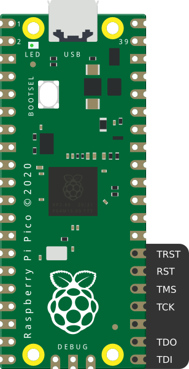
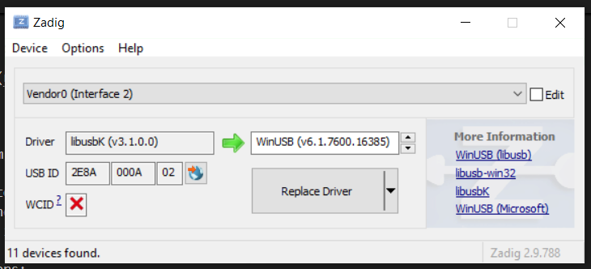
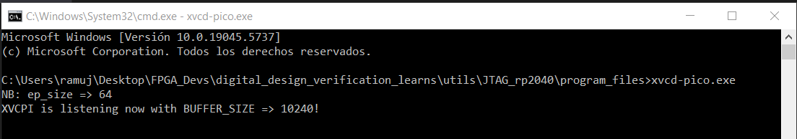
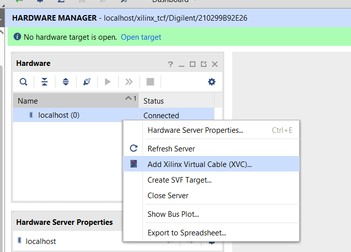
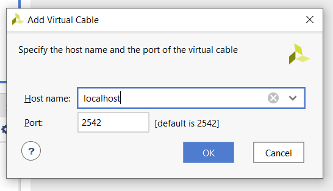

# Using a Rasberry Pico as a JTAG

A cheap and open source method to program and FPGA is using a Rasberry Pico as a JTAG cable. In order to do it you will find the instructions based on the Github open-source project [pico-xvc repository](https://github.com/kholia/xvc-pico). In folder *program_files* exists the necessary files to perform a Xilinx FPGA load using a Windows Computer. 

## Conexions: 

The pinout is as follows:

## Steps:

1. Load the program into the la Rasberry Pi (RP2040):

* Pressing the buttons BOOT and RST insert the USB cable into the computer
* When releasing the buttons, a new window would appear in the files explorer
* Put the uf2 file into that folder

2. Change the drivers:

* Install Zading in the host computer (https://zadig.akeo.ie/)
* Using Zadig install *libusbK* to the new device. You can disconnect and connect it again in order to know which is it.

3. Execute the xvc-pico.exe from command window.

4. From Vivado Hardware Manager, add the Virtual Cable with the host IP.

5. Now it act as a normal JTAG adapter. Every time you want to use it, it is necessary to only do steps 3 and 4. 

## Programming the configuration flash with a script

[`program_flash.bat`](program_flash.bat) and [`program_flash.tcl`](program_flash.tcl) do steps 3 and 4 and the whole flash-programming dialog of the Hardware Manager without the GUI. They are written to sit in a project's `scripts/` folder next to a `build_project.tcl` that leaves `<project>.mcs` in `../output/`, so copy both there.

1. Edit the variables at the top: in the `.bat`, the Vivado installation and the folder holding `xvcd-pico.exe`; in the `.tcl`, the project name (or the `.mcs` path), the device as Vivado lists it (`xc7s50_0`) and the flash part fitted on the board (`s25fl128l-spi-x1_x2_x4`).
2. Plug in the Pico and power the board.
3. Run `program_flash.bat`. It starts `xvcd-pico` in the background (or uses one already running), erases, programs and verifies the flash, stops `xvcd-pico` again and leaves the Vivado output in `program_flash.log`.
4. **Power cycle the board.** The FPGA only loads the new design from the flash at power-up, and the script cannot do this step.

The script stops with an error if `xvcd-pico` cannot be reached, the device is not in the JTAG chain, the `.mcs` file is missing, or programming or verification fails.

The first attempt after starting `xvcd-pico` finds no devices ("No devices detected on target localhost:2542"), even after a wait. The second one, after the target is registered again, finds the FPGA. So the script waits `connect_delay_ms` before each attempt and re-registers the target before each retry, up to `connect_attempts` tries in total (both at the top of the `.tcl`). The error on the first try in the log is therefore expected.

🧪 Status: tested on real hardware on 2026-10-15: the Drone FPGA_SOM board (Spartan-7 xc7s50, `s25fl128l` flash), two runs. Both found the device on the second try and programmed and verified the flash in under 2 minutes.
