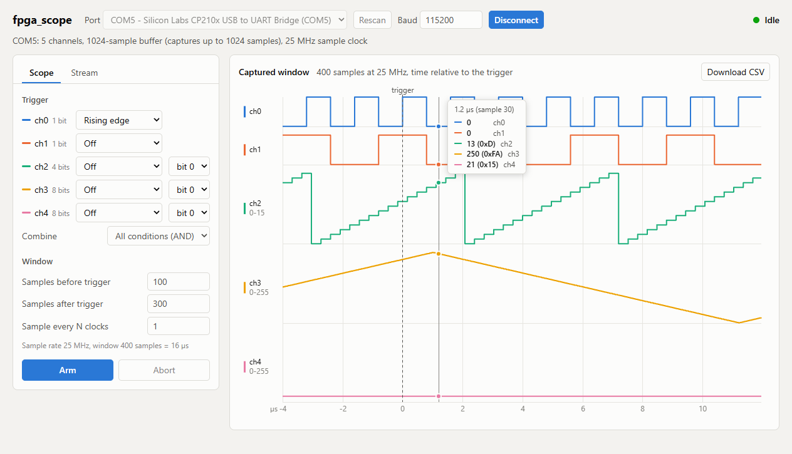
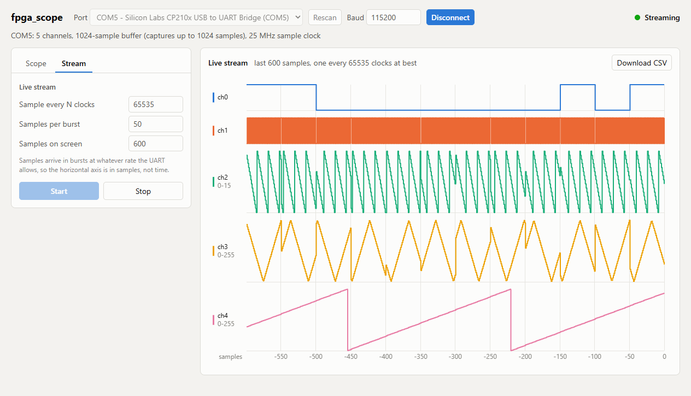

# FPGA Scope

A small logic analyzer / oscilloscope that lives inside your FPGA design. You connect up to 8 internal signals to it, and look at them from a browser through a plain USB-UART adapter. No vendor tool, no JTAG and no special hardware are needed while debugging.



It has two modes, selected from the GUI:

- **Scope**: waits for a trigger, captures a window of samples around it at full clock speed into block RAM, then uploads it. For fast signals.
- **Stream**: sends samples continuously as fast as the UART allows. For slow signals you want to watch live.



✔️ Verified via testbenches: the RTL core with a simulated host ([testbench](test/scope_tb.v)) and the Python side with unit tests ([backend tests](gui/backend/)).

🧪 Status: Tested on real hardware with the [example design](example/scope_example_top.v) on a Spartan-7 (xc7s50) board with a 25 MHz clock, at 115200 baud through a CP210x USB-UART adapter: 3000 commands without a lost reply, captures and streams matching the generated signals, and the GUI working end to end. Other devices, clocks and baud rates have not been tried.

📁 [Source Code](source/)

📁 [Testbench](test/scope_tb.v)

📁 [Example design](example/scope_example_top.v)

📁 [GUI](gui/)

## Documentation

| Document | What it is for |
|----------|----------------|
| [Integration guide](docs/integration.md) | Step by step: add the scope to a design, pick the parameters, assign the pins, first contact |
| [Protocol](docs/protocol.md) | The UART wire protocol between the computer and the FPGA |
| [Status and roadmap](docs/TODO.md) | What is done, what is tested, design decisions, what is left |

## Quick start

**1. Try the GUI without any hardware.** You need Python 3.

```bash
cd utils/fpga_scope/gui/backend
pip install -r requirements.txt
python app.py
```

Open http://127.0.0.1:8000, leave the port on *sim - Simulated device*, click **Connect** and then **Arm**. The simulated device produces two square waves, a ramp and a sine.

**2. Put it in your FPGA.** Follow the [integration guide](docs/integration.md). The quickest first test is the [example design](example/scope_example_top.v), which generates its own signals and needs only a clock, a reset and the two UART pins.

**3. Connect to the board.** Check the link from the command line first, then use the GUI with the real port:

```bash
python scope_cli.py --port COM5 --baud 115200 info
python app.py
```

## 📌 Instantiation

```verilog
scope_top # (
    .p_num_channels(),      /* Number of channels, 1-8 */
    .p_ch0_width(),         /* Bits of each channel, 1-8 (one parameter per channel, ch0 to ch7) */
    .p_ch1_width(),
    .p_buffer_depth_log2(), /* Capture buffer holds 2^N samples */
    .p_uart_preescaler(),   /* Clock frequency / baudrate */
    .p_clk_freq_hz()        /* Clock frequency in Hz, shown on the GUI time axis */
) scope_top (
    .clk(),
    .rst(),        /* Synchronous reset, active high */
    .i_ch0(),      /* Channel inputs, always 8 bits wide: pad narrower signals with zeros */
    .i_ch1(),
    .i_ch2(),
    .i_ch3(),
    .i_ch4(),
    .i_ch5(),
    .i_ch6(),
    .i_ch7(),
    .i_uart_rx(),  /* From the USB-UART adapter's TXD */
    .o_uart_tx()   /* To the USB-UART adapter's RXD */
);
```

The scope also needs `uart_tx.v` and `uart_rx.v` from the [UART module](../../modules/uart/uart.md).

## What is in this folder

| Folder | Contents |
|--------|----------|
| `source/` | The RTL core. `scope_top.v` is the module you instantiate |
| `example/` | A complete top level with built-in test signals |
| `test/` | RTL testbench. Run it with `python run.py` from that folder (needs Icarus Verilog) |
| `gui/backend/` | Python: the protocol client, a command-line tool, the web server and a simulated device |
| `gui/frontend/` | The web page (plain HTML, JavaScript and CSS, nothing to build) |
| `docs/` | Integration guide, protocol and roadmap |

## Running the tests

```bash
cd utils/fpga_scope/test
python run.py                 # RTL: ends with "[PASS] All checks passed."

cd ../gui/backend
python -m unittest test_protocol test_scope_cli test_app
```

## Limits worth knowing

- Up to 8 channels of up to 8 bits each. A wider bus is split over several channels.
- All signals must be synchronous to the clock given to the scope.
- A capture holds at most `2^p_buffer_depth_log2` samples, and at most 65535 bytes in total.
- The baud rate is fixed at build time by `p_uart_preescaler`; there is no autobaud.
- In Stream mode the sample rate is limited by the UART and is not guaranteed, so that view has no time axis.
